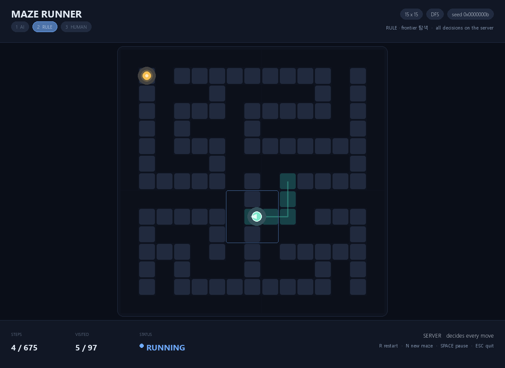

# Maze Runner — 서버 권위 미로 게임 (LoRA-BERT + 규칙)

미로를 푸는 지능을 **서버 안에** 가두고, SDL 클라이언트는 서버가 보내준 상태를
**그리기만** 하는 프로젝트입니다. 실행 중에 **AI 구현체 / 규칙 구현체 / 사람**을 골라
같은 미로에서 바로 비교할 수 있습니다.

```
┌───────────────────────────────┐        ┌──────────────────────────────┐
│  viewer/  (pygame SDL)        │  HTTP  │  app/api/  (FastAPI)         │
│  렌더링 · 입력 · 애니메이션     │ ─────▶ │  미로 · 관측 · 이동 결정       │
│  경로 탐색 코드 0줄            │ ◀───── │  벽 판정 · 승리 판정           │
└───────────────────────────────┘        │  ai | rule | human           │
                                         └──────────────────────────────┘
```

- **이동 결정·벽 판정·승리 판정의 권위는 서버에만** 있습니다 (PLAN §1 R2·R3).
- **클라이언트에는 경로 탐색 코드가 없습니다.** 서버 응답을 복사해서 그릴 뿐입니다 (R1).
- **서버가 응답하지 않으면 클라이언트는 이동하지 않습니다** — 화면 상단에
  `NO SERVER RESPONSE — NOT MOVING` 배너가 뜹니다 (R4).



## 문서

| 문서 | 내용 |
|---|---|
| [설계 문서](docs/DESIGN.md) | 아키텍처, 관측/API 계약, R1~R4, 동시성, 테스트 전략 |
| [빌드/실행 안내](docs/BUILD.md) | 설치, 런처/두 터미널 실행, 학습 파이프라인, 문제 해결 |
| [사용 가이드](docs/USAGE.md) | GUI가 클라이언트로서 어떤 API를 호출하는지, 직접 호출 예시 |
| [의사결정 기록](docs/DECISIONS.md) | 시간순 ADR — 왜 지금 이런 구조인가 (실패 포함) |
| [프루닝 보고서](docs/PRUNE.md) | 워드 임베딩 제거 전후 용량·실제 플레이 비교 |
| [독립 추론 API](docs/INFERENCE.md) | 게임 세션 없이 관측 시계열로 행동을 추론하는 HTTP API |
| [계획/실험 로그](PLAN.md) | 마일스톤과 실측 원본 |

## 빠른 시작

```powershell
cd server
python -m pip install -r requirements.txt
```

### 한 번에 실행 (테스트 런처)

```powershell
# 저장소 루트에서
python test_launcher.py                       # 서버 + AI 클라이언트
python test_launcher.py --brain rule          # 규칙: 왼손 법칙
python test_launcher.py --brain human         # 사람
```

- 서버를 먼저 띄우고 `/health` 가 응답하면 클라이언트를 실행합니다.
- 포트가 사용 중이면 빈 포트로 자동 이동합니다 (`--port 0` 은 항상 자동).
- 클라이언트 창을 닫으면 서버도 함께 종료됩니다. Ctrl+C 로도 정리됩니다.
- 알 수 없는 인자는 그대로 `viewer.app` 으로 전달됩니다 (`--size`, `--seed`, `--snapshot` …).
- `--no-server --url http://127.0.0.1:8000` 은 이미 떠 있는 서버에 연결,
  `--no-client` 는 서버만 실행합니다.

### 터미널 1 — 서버

```powershell
cd server
uvicorn app.api.main:app --port 8000
```

`http://127.0.0.1:8000/docs` 에서 API 문서를 볼 수 있습니다.

### 터미널 2 — 클라이언트

```powershell
cd server

python -m viewer.app --size 15                     # AI 구현체 (기본)
python -m viewer.app --brain rule                  # 규칙: 왼손 법칙
python -m viewer.app --brain rule --rule frontier  # 규칙: 지식 지도 탐색
python -m viewer.app --brain human                 # 사람
```

실행 중에도 바꿀 수 있습니다.

| 키 | 동작 |
|---|---|
| `1` / `2` / `3` | AI / 규칙 / 사람 구현체 선택 (상단 칩 클릭도 동일) |
| 방향키 / WASD | 사람 모드에서 이동 |
| R | 같은 미로 다시 시작 |
| N | 새 미로 |
| SPACE | 일시정지 |
| ESC / Q | 종료 |

구현체를 바꾸면 **같은 미로에서 스텝 0으로** 돌아갑니다(관측 정의가 다르기 때문).
미로 seed 는 유지되므로 "같은 판에서 AI와 규칙을 번갈아 비교"가 됩니다.

### 옵션

| 옵션 | 설명 |
|---|---|
| `--server URL` | API 주소 (기본 `http://127.0.0.1:8000`) |
| `--size N` | 미로 크기 (홀수, 5~31) |
| `--seed N` | 미로 시드 (재현용) |
| `--algorithm dfs\|prim` | 미로 생성 알고리즘 |
| `--brain ai\|rule\|human` | 이동 결정 구현체 |
| `--rule wall\|frontier` | 규칙 구현체 종류 |
| `--step-interval 0.05` | AI/규칙 스텝 간격(초) |
| `--fixed-endpoints` | 시작/목적지 고정 |

AI 체크포인트는 **서버**가 고릅니다: `MAZE_CHECKPOINT` → `checkpoints/wall` →
`checkpoints/v3` → 가장 최근 `*/best.pt`. 클라이언트는 경로를 모릅니다.

### 헤드리스 스냅샷 (CI/문서용)

```powershell
$env:SDL_VIDEODRIVER = "dummy"
python -m viewer.app --brain rule --snapshot shot.png --snapshot-frame 120
```

## 구현체

| 구현체 | 이동 결정 | 관측 |
|---|---|---|
| `ai` | LoRA-BERT 체크포인트 (`checkpoints/wall`) | 3×3 창 + 방문 이력 + 전역 요약 (54차원) |
| `rule` / `wall` | 왼손 법칙 (`wall_follow_action`) | 3×3 창 + 직전 행동 |
| `rule` / `frontier` | 지식 지도 위 BFS 탐색 (`frontier_action`) | 3×3 창 + 누적 지식 지도 (479차원) |
| `human` | 클라이언트가 보낸 행동 (서버가 벽 판정) | — |

## API

| 메서드 | 경로 | 역할 |
|---|---|---|
| GET | `/health` | 상태 + 선택된 체크포인트 + `model_loaded` |
| GET | `/brains` | 구현체 목록 |
| GET | `/models` | 추론 모델의 관측 차원·시퀀스 길이 |
| POST | `/predict` | 관측 시계열 → 행동·확률 (게임 세션 불필요) |
| POST | `/games` | 판 생성 |
| GET | `/games/{id}` | 현재 상태 |
| POST | `/games/{id}/advance` | Brain 이 스스로 이동 |
| POST | `/games/{id}/action` | 사람 행동 적용 |
| POST | `/games/{id}/brain` | 구현체 교체 |
| POST | `/games/{id}/reset` | 같은 미로 재시작 |
| POST | `/games/{id}/new-maze` | 새 미로 |
| DELETE | `/games/{id}` | 세션 종료 |

### 독립 추론 (게임 세션 없이)

```powershell
# 모델이 기대하는 관측 차원 확인
Invoke-RestMethod http://127.0.0.1:8000/models

# 관측 1개로 행동 추론 (54차원 예시)
$body = '{"observations": [[' + (('0,' * 53) + '0') + ']]}'
Invoke-RestMethod -Method Post -Uri http://127.0.0.1:8000/predict `
  -ContentType 'application/json' -Body $body
```

계약·오류·시퀀스 규칙은 [`docs/INFERENCE.md`](docs/INFERENCE.md) 참고.

## 학습 파이프라인

```powershell
cd server

# 1) 합성 데이터셋 — 왼손 법칙 전문가 라벨 (미로 단위 8:1:1 분할)
python -m training.gen_dataset --mazes 240 --sizes 9,11,13,15 --out data/wall --workers 4

# 2) LoRA-BERT 학습
python -m training.train --data data/wall --epochs 4 --out checkpoints/wall --lora-r 32 --lora-lr 3e-4

# 3) 롤아웃 평가 (정확도가 아니라 실제 탈출 성공률)
python -m training.evaluate --checkpoint checkpoints/wall/best.pt --data data/wall --limit 40

# 4) AI vs 규칙 벤치마크 (같은 미로 집합)
python -m training.compare_brains --mazes 60 --size 15

# 5) 워드 임베딩 프루닝 (체크포인트 17.38 MiB → 2.48 MiB, 동작 동일)
python -m training.prune_embeddings --checkpoint checkpoints/wall/best.pt --out checkpoints/wall_pruned
```

## 구조

```
test_launcher.py       # 서버 + 클라이언트 동시 실행
docs/
├── DESIGN.md          # SW 설계 문서
├── BUILD.md           # 빌드/실행 안내
├── USAGE.md           # GUI/API 사용 가이드
├── DECISIONS.md       # 의사결정 기록
├── PRUNE.md           # 워드 임베딩 프루닝 보고서
├── INFERENCE.md       # 독립 추론 API 계약
└── screenshot-rule.png
server/
├── app/
│   ├── api/           # FastAPI 서버 — 게임의 유일한 권위
│   │   ├── main.py    #   엔드포인트
│   │   ├── session.py #   한 판 (미로 + MazeEnv + Brain)
│   │   ├── brains.py  #   ai | rule | human
│   │   └── schemas.py #   클라이언트와 공유하는 계약
│   ├── game/          # 미로 생성, 환경/관측, 규칙 전문가, (평가 전용) BFS
│   └── ml/            # LoRA, BERT 정책, 슬라이딩 윈도우 실행기
├── training/          # 데이터 생성, 학습, 평가, DAgger, 구현체 비교, 프루닝
├── viewer/            # SDL 클라이언트 — 렌더링 + 입력 (경로 탐색 없음)
│   ├── app.py         #   이벤트 루프
│   ├── api_client.py  #   stdlib urllib HTTP
│   ├── remote.py      #   서버 JSON → 화면 상태
│   ├── render.py      #   그리기 전용
│   └── layout.py      #   순수 레이아웃 계산 (pygame 비의존)
└── tests/             # 171 tests
```

## 테스트

```powershell
cd server
python -m pytest
```

설계 불변 규칙은 테스트로 고정되어 있습니다.

- `test_viewer_has_no_pathfinding_code`, `test_client_modules_do_not_import_torch_or_the_game_rules` — R1
- `test_server_state_is_mirrored_not_recomputed` — R2
- `test_server_rejects_client_action_that_hits_a_wall` — R3
- `test_no_movement_when_the_server_does_not_answer` — R4

## 현재 상태

- 서버/클라이언트 분리 완료. 세 구현체(AI·규칙·사람)를 GUI에서 즉시 교체할 수 있습니다.
- `checkpoints/wall` (왼손 법칙 라벨, LoRA r=32) 은 롤아웃 성공률 **100%** 입니다.
- `checkpoints/wall_pruned` 는 추론에 쓰이지 않는 `word_embeddings` 를 제거한 사본입니다.
  **17.38 MiB → 2.48 MiB (−85.8%)** 이고, 같은 60 미로에서 행동·성공률·스텝이 완전히 동일합니다
  ([`docs/PRUNE.md`](./docs/PRUNE.md)).
- 다만 그 성공률은 **규칙을 그대로 증류했기 때문**입니다. 아래 실측 참고.

### 규칙 vs AI (같은 미로, 15×15)

60 미로 · 15×15 · seed 90000~90059 · `python -m training.compare_brains --mazes 60 --size 15`

| 구현체 | 성공 | 평균 스텝 | optimality | 루프율 |
|---|---|---|---|---|
| `ai` — `checkpoints/wall` (LoRA-BERT) | 60/60 | 96.9 | 1.865 | 0.19 |
| `rule` — 왼손 법칙 | 60/60 | 96.9 | 1.865 | 0.19 |
| `rule` — frontier 탐색 | 60/60 | **94.7** | **1.851** | **0.17** |

같은 미로에서 짝지어 비교하면:

- **AI vs 왼손 법칙: 60/60 판에서 스텝 수가 완전히 동일** (더 빠름 0 · 동일 60 · 더 느림 0).
  AI는 규칙을 그대로 증류했기 때문에 규칙과 구별되지 않습니다.
- **frontier vs 왼손 법칙: 더 빠름 30 · 동일 4 · 더 느림 26** (평균 −2.3 스텝).
  같은 규칙 계열 안에서도 더 나은 전략이 학습된 모델보다 앞섭니다.

- `checkpoints/wall` 은 왼손 법칙의 **충실한 증류**입니다. 성공률·스텝·실패 모드가 같고,
  더 강한 규칙(`frontier`)보다 느립니다.
- 관측에 지식 지도(belief map, 479차원)를 추가해 `frontier` 교사를 학습시켰지만
  **BC 62.5% / DAgger 37.5%** 로 실패했습니다. 라벨은 관측으로 완전히 재현되므로
  원인은 라벨이 아니라 **표현력**입니다(선형 투영 + BERT-tiny 로는 BFS 불가).
- 결론: **이 게임에서는 규칙을 서버에 넣는 것이 정답**입니다. LoRA의 가치는 성능이 아니라
  관측→행동 계약과 "규칙으로 쓸 수 없는 것"을 배우는 데 있습니다.
  자세한 분석은 [`PLAN.md`](./PLAN.md) §14 W2.7·W3.
